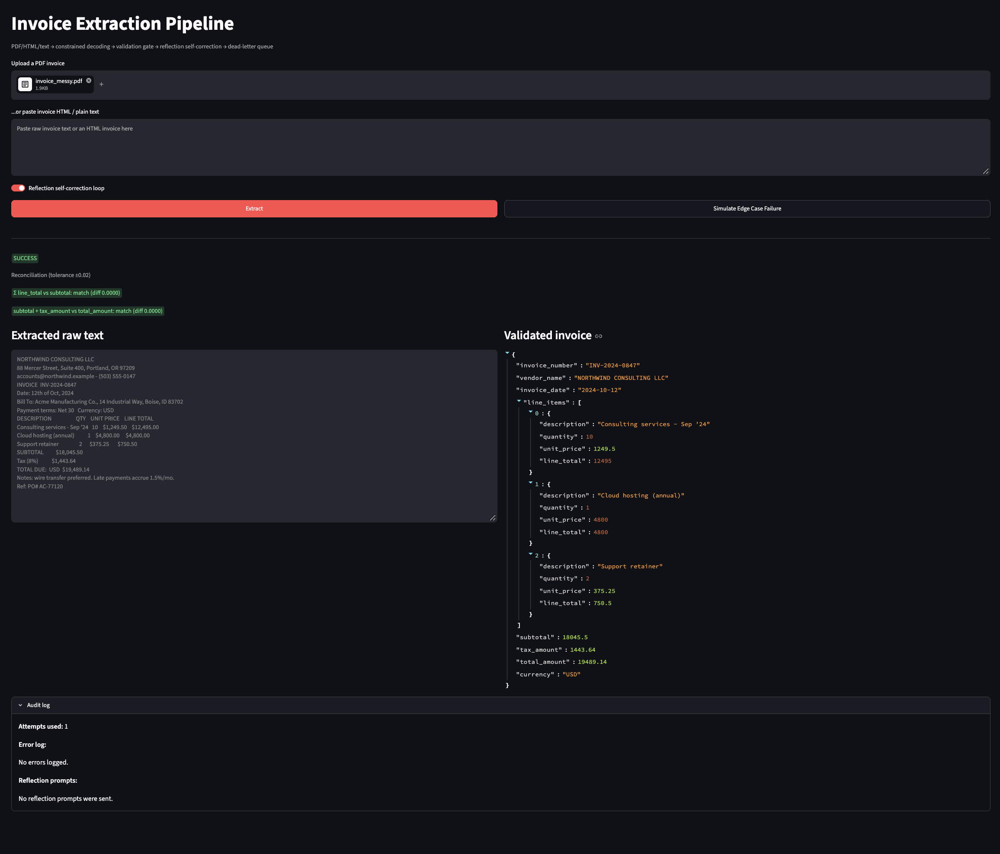
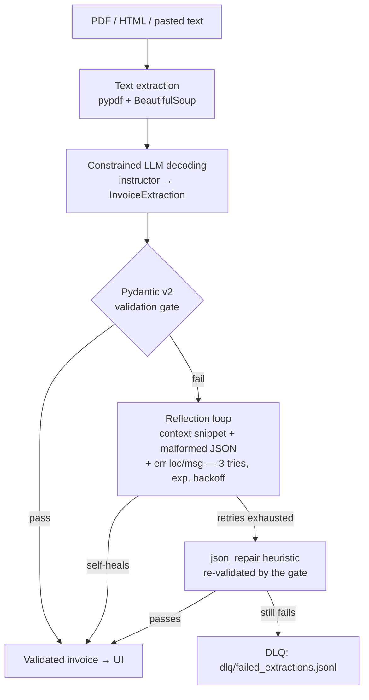

# structured-data-extractor

A fault-tolerant pipeline that turns messy PDFs and HTML documents (commercial
invoices) into strictly validated Pydantic v2 records using LLM structured
output. When validation fails, the pipeline self-corrects through a bounded
reflection loop, falls back to `json_repair` heuristics, and finally routes
unrecoverable payloads to a dead-letter queue (DLQ). A Streamlit UI provides
upload, side-by-side output, and audit logging.

> **Status: work in progress.** Built milestone by milestone per
> `docs/week4_work_plan.md` (spec in `docs/week4_assignment.md`).
> M0–M5 are done: the extraction pipeline, reflection/repair fallbacks,
> DLQ, Streamlit UI, and test suite (23 tests) are implemented.
> Remaining: M6 packaging/deployment, M7 submission polish.

## Demo

- **Live app:** https://your-app.streamlit.app (TBD)




*Screenshot: Clean extraction — status `SUCCESS`, both reconciliation checks green.*  

## Architecture



## Schema

**`InvoiceExtraction`**

| Field | Type | Rule |
|---|---|---|
| `invoice_number` | `str` | regex `^[A-Za-z0-9-]{3,20}$` |
| `vendor_name` | `str` | required |
| `invoice_date` | `date` | ISO-8601 or messy forms via `parse_date` |
| `line_items` | `list[LineItem]` | at least one item |
| `subtotal` / `tax_amount` / `total_amount` | `float` | ≥ 0 |
| `currency` | `Literal` | `USD` / `EUR` / `GBP` |

**`LineItem`** — `description` (str), `quantity` (int > 0),
`unit_price` (float > 0), `line_total` (float ≥ 0)

**Cross-field rule** (`@model_validator`, ±0.02 tolerance):
`sum(line_total) ≈ subtotal` **and** `subtotal + tax_amount ≈ total_amount`

Messy values (`"$1,249.50"`, `"12th of Oct, 2024"`) are pre-parsed in
`src/normalize.py` before Pydantic sees them.

**`ExtractionResult`** — `validated_data` (`InvoiceExtraction | None`),
`attempts_used` (int), `error_log` (`list[str]`),
`execution_status` (`SUCCESS` | `REPAIRED_VIA_REFLECTION` | `DLQ_FAILED`)

**Stack:**

- Python 3.11 + uv — interpreter, package/env management
- Pydantic v2 — strict data contracts; the validation gate
- `instructor` + Anthropic (Claude) — constrained structured output
- `pypdf` / `beautifulsoup4` — PDF and HTML text ingestion
- `json-repair` — last-resort repair of malformed LLM JSON
- Streamlit — upload, results, and audit-log UI
- pytest — deterministic test suite, LLM fully mocked

## Setup

Requires Python 3.11 and [uv](https://docs.astral.sh/uv/).

```bash
uv sync
cp .env.example .env   # then add your ANTHROPIC_API_KEY and set EXTRACTOR_MODEL
```

`.env` is gitignored; only `.env.example` (with placeholder values) is
committed. Never commit real API keys.

The default extractor is `claude-haiku-5-5` (cheapest; extraction is its stated
use case). If it struggles on the messy samples, upgrade `EXTRACTOR_MODEL` to
e.g. `claude-sonnet-5-5`.

## Commands

```bash
uv run pytest -v                    # run the test suite
uv run streamlit run src/app.py     # start the web UI
```

## Project structure

```
structured-data-extractor/
├── pyproject.toml
├── .python-version         # Python 3.11 pin
├── .env.example            # placeholder env vars — copy to .env and fill in
├── .gitignore
├── README.md
├── ai_prompt_log.md        # AI generation prompts, raw output, audit findings
├── .devin/
│   └── skills/web-qa/      # /web-qa project QA checklist (manual trigger)
├── docs/
│   ├── week4_assignment.md # assignment spec
│   ├── week4_work_plan.md  # milestone plan M0–M7
│   ├── agent_setup.md      # M0 secrets/permissions setup procedure
│   └── screenshots/        # bug evidence (e.g. reflection crash)
├── samples/
│   ├── invoice_messy.pdf
│   ├── vendor_contract.html
│   ├── invoice_bad_math.txt  # sum mismatch — demos the reflection loop
│   └── invoice_bad_date.txt  # impossible date — demos validation failure
├── src/
│   ├── __init__.py
│   ├── schemas.py          # Pydantic v2 models
│   ├── normalize.py        # money/date pre-parsers for messy values
│   ├── extractor.py        # extraction + validation engine
│   ├── fallback.py         # reflection re-prompting + heuristic repair
│   └── app.py              # Streamlit UI
├── dlq/
│   └── failed_extractions.jsonl  # dead-letter sink (gitignored)
└── tests/
    ├── __init__.py
    ├── test_extraction.py  # Tests 1–3: schema + golden extraction
    └── test_fallbacks.py   # Tests 4–5: reflection + DLQ
```

## AI audit summary

First drafts were generated by an AI agent (`devin/swe-2-high`); a separate
review-only audit pass then graded the draft against the four required
anti-pattern classes. Full prompt/output/findings in `ai_prompt_log.md`.

- **Generation:** one fully-specified prompt produced the schemas,
  extractor, and fallback in one shot (M2 baseline, committed untouched)
- **Audit findings:** 15 findings — 1 blocker, 4 high, 1 medium, the rest
  low. Notables: an unguarded API call inside the reflection loop that
  could crash the pipeline; `parse_money`/`parse_date` never applied on the
  fallback paths; a hallucinated `exc.raw_output` attribute so reflection
  never saw the real malformed JSON; `except Exception` routing auth
  errors into the repair loop
- **Fixes:** findings 1–4 fixed test-first on `m3-audit`, findings 7–12 on
  `m4-resilience`; two more real bugs surfaced during M5 UI testing
  (`ThinkingBlock` crash in the reflection loop, `last_raw` capturing the
  API envelope instead of the model output) — both fixed with regression
  tests. 23 tests green
- **Clean:** no Pydantic v1 usage, no hard-coded secrets, bounded retries
  with exponential backoff

## Bug fixes

Real bugs found during audit and live testing, each fixed with a
regression test (details in `ai_prompt_log.md`):

| Bug | Root cause | Fix |
|---|---|---|
| Reflection loop crashed on API errors | unguarded `messages.create` inside the retry loop | `2c8dda2` |
| Messy values hit Pydantic unparsed | `parse_money`/`parse_date` dead on the primary path, absent on fallback/repair | `0d72718` |
| Reflection prompt lacked real malformed JSON | `getattr(exc, "raw_output")` was a hallucinated attribute | `eee7903` |
| Auth/network errors fed into repair loop | `except Exception` misclassified non-retryable errors | `9211635` |
| Every reflection attempt crashed | `resp.content[0].text` — Haiku returns a `ThinkingBlock` first | `a31add0` |
| `last_raw` was the API envelope | dumped the whole `Message` instead of the `tool_use` input | `6638065` |

---

*Built for AD331 — Artificial Intelligence, North Seattle College, Fall 2026.
Directed by Laurie Roy; built with AI.*
