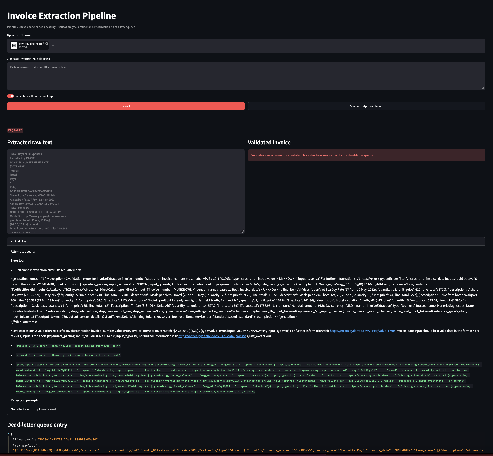

# AI Prompt Log

## M1 — Data contract (schemas + tests 1–3)

- **Model used:** devin/swe-2-high (self-reported)
- **Date:** 2026-11-21

### Prompt (verbatim)

```text
You are a Staff AI Systems Engineer. Build the data-contract layer for a
fault-tolerant pipeline that extracts commercial-invoice data from messy
PDFs/HTML into strictly validated Pydantic v2 records.

Produce exactly three files. Do NOT write LLM, extraction, or retry logic —
only the contract, its validators, tests, and two small normalization helpers.

### src/normalize.py
Pre-parsers that convert messy raw strings into clean Python values BEFORE
Pydantic sees them:
- parse_money(value) -> float — accepts "$1,249.50", "1249.50", 1249.5, 1249;
  raises ValueError on anything unparseable
- parse_date(value) -> date — accepts date objects, ISO-8601 strings, and
  non-standard forms like "12th of Oct, 2024"; raises ValueError on
  unparseable input

### src/schemas.py  (Pydantic v2 ONLY)
- LineItem: description: str, quantity: int, unit_price: float,
  line_total: float
- InvoiceExtraction: invoice_number: str, vendor_name: str,
  invoice_date: date, line_items: list[LineItem] (at least one item),
  subtotal: float, tax_amount: float, total_amount: float,
  currency: Literal["USD", "EUR", "GBP"]
- @field_validators enforcing: quantity > 0, unit_price > 0,
  line_total/subtotal/tax_amount/total_amount >= 0, and invoice_number
  matching a documented regex (e.g. ^[A-Za-z0-9-]{3,20}$)
- @model_validator(mode="after") enforcing the reconciliation rule:
  sum(line_total) ≈ subtotal AND subtotal + tax_amount ≈ total_amount,
  each within 0.02 absolute tolerance; on failure raise ValueError naming
  the field and showing the computed difference
- ExtractionResult: validated_data: Optional[InvoiceExtraction],
  attempts_used: int, error_log: list[str],
  execution_status: Literal["SUCCESS", "REPAIRED_VIA_REFLECTION",
  "DLQ_FAILED"]

Hard constraints:
- Pydantic v2 API only: @field_validator, @model_validator(mode="after"),
  .model_dump(). Never @validator, never .dict().
- Failures raise — never return partial or all-None objects.

### tests/test_extraction.py
Deterministic pytest tests; no LLM calls:
1. test_golden_payload_validates — hand-built clean payload validates;
   every LineItem populated; currency in {USD, EUR, GBP}
2. test_schema_rejects_bad_constraints — quantity = 0 and negative
   total_amount each raise ValidationError
3. test_reconciliation_rejects_mismatched_sums — sum(line_total) off from
   subtotal by > 0.02, and subtotal + tax_amount off from total_amount,
   each raise ValidationError
4. test_normalize_parsers — parse_money("$1,249.50") == 1249.50;
   parse_date("12th of Oct, 2024") == date(2024, 10, 12)
```

### What was generated

- `tests/test_extraction.py` — 4 tests (golden payload, constraint rejection, reconciliation rejection, normalize parsers)
- `src/schemas.py` — `LineItem`, `InvoiceExtraction`, `ExtractionResult`
- `src/normalize.py` — `parse_money`, `parse_date`

### Bugs / issues found

None found — generated code passed all 4 tests on first run (`uv run pytest -v`, 4 passed).

### Fixes made

None. Raw output committed as-is on `m1-schemas`. Empty M0 stubs removed
(`tests/test_schemas.py`, `test_extractor.py`, `test_fallback.py`, `test_app.py`).

## M2 — Baseline AI draft (captured untouched)

- **Model used:** devin/swe-2-high (self-reported)
- **Date:** 2026-11-21

### Prompt (verbatim)

```text
You are a Staff AI Systems Engineer. Build the extraction and resilience
layers of a fault-tolerant pipeline that turns messy PDFs/HTML into
strictly validated Pydantic v2 invoice records, using Anthropic's Claude
via the `instructor` library.

The data contract already exists and is tested — import it, do NOT modify
or regenerate it:

- src/schemas.py: LineItem, InvoiceExtraction (field validators plus a
  model_validator enforcing sum(line_total) ≈ subtotal and
  subtotal + tax_amount ≈ total_amount, each within 0.02), and
  ExtractionResult(
      validated_data: Optional[InvoiceExtraction],
      attempts_used: int,
      error_log: list[str],
      execution_status: Literal["SUCCESS", "REPAIRED_VIA_REFLECTION",
                                "DLQ_FAILED"],
  )
- src/normalize.py: parse_money(value) -> float and
  parse_date(value) -> date, which clean strings like "$1,249.50" and
  "12th of Oct, 2024" before Pydantic sees them.

Produce exactly two files, plus a runnable __main__ demo in extractor.py.
No tests — they come later.

### src/extractor.py — ingestion + Stage 1
- extract_text(source): accepts a file path, bytes, or raw string; pulls
  text from PDFs with pypdf and from HTML with beautifulsoup4; returns
  plain text.
- LLM client: instructor-wrapped Anthropic client. Read ANTHROPIC_API_KEY
  and the model name from the EXTRACTOR_MODEL environment variable
  (python-dotenv loads .env locally). Never hard-code a key or model
  name.
- extract_with_retry(raw_text: str, max_retries: int = 3)
  -> ExtractionResult
  Stage 1: constrained decoding — one instructor call returning
  InvoiceExtraction, then feed messy fields through parse_money /
  parse_date before final validation. On success return
  ExtractionResult(execution_status="SUCCESS", attempts_used=1).
- `if __name__ == "__main__":` block: run extraction on
  samples/invoice_messy.pdf and print the ExtractionResult.

### src/fallback.py — Stage 2 + Stage 3
- Stage 2 reflection loop: on ValidationError, re-prompt with ONLY the
  relevant context snippet from the source text, the previous malformed
  JSON, and the exact err['loc'] / err['msg'] entries — never resend the
  full document. Bounded retries (max_retries=3) with exponential
  backoff. Success here returns
  ExtractionResult(execution_status="REPAIRED_VIA_REFLECTION").
- Stage 3: after retries are exhausted, run json_repair on the last raw
  payload and re-validate the repaired output through InvoiceExtraction —
  repair never bypasses the validation gate.
- If all stages fail: append a DLQ entry to
  dlq/failed_extractions.jsonl (one JSON object per line: timestamp, raw
  payload, error list, failure flag) and return
  ExtractionResult(validated_data=None, attempts_used=<n>,
  error_log=[...], execution_status="DLQ_FAILED"). The failure path must
  never raise and never return a partial or all-None invoice object.

Hard constraints:
- Pydantic v2 API only: @field_validator, @model_validator(mode="after"),
  .model_dump(). Never @validator, never .dict().
- Every failure path returns an explicit ExtractionResult — the pipeline
  never crashes and never swallows errors silently.
- Secrets come from environment variables only.
```

### What was generated

- `src/extractor.py` — `extract_text` (PDF/HTML/raw-string ingestion),
  `_clients` (env-configured instructor + raw Anthropic clients),
  `extract_with_retry` (Stage 1 constrained decoding + defensive
  re-normalization), `__main__` demo on `samples/invoice_messy.pdf`
- `src/fallback.py` — `run_fallback` (Stage 2 reflection loop with
  `_context_snippet` window extraction and exponential backoff, Stage 3
  `json_repair` + re-validation, DLQ writer to
  `dlq/failed_extractions.jsonl`)

### Bugs / issues found

None found at runtime — `uv run python -m src.extractor` on
`samples/invoice_messy.pdf` returned `execution_status="SUCCESS"` on
attempt 1 with all fields populated (INV-2024-0847, Northwind Consulting
LLC, 3 line items, USD). `uv run pytest -v`: 4 passed.

### Fixes made

None — baseline committed untouched; fixes are M3 scope.

## M3 — Staff-engineer audit of M2 draft (review only)

- **Model used:** devin/swe-2-high (self-reported)
- **Date:** 2026-11-21

### Prompt (verbatim)

```text
You are a senior staff engineer reviewing an AI-generated first draft of a
fault-tolerant LLM extraction pipeline. This is a REVIEW-ONLY task: find
and explain problems — do not edit, rewrite, or "fix" any code.

Review these files:
- src/extractor.py  (ingestion + Stage 1 constrained decoding)
- src/fallback.py   (Stage 2 reflection loop + Stage 3 json_repair + DLQ)
- src/schemas.py and src/normalize.py are context only — already tested;
  flag misuse of them by the two files above, not the files themselves.

Context: commercial-invoice extraction; Anthropic Claude via `instructor`.
ExtractionResult contract: validated_data / attempts_used / error_log /
execution_status ("SUCCESS" | "REPAIRED_VIA_REFLECTION" | "DLQ_FAILED").

Check for these four anti-patterns, in order:
1. Pydantic v1/v2 collisions — @validator instead of
   @field_validator/@model_validator; .dict() instead of .model_dump()
2. Context stuffing / token bloat — is the whole document re-sent on
   every retry instead of the relevant snippet plus targeted errors?
3. Silent error swallowing — does any failure path return a half-empty or
   all-None object, swallow exceptions, or hide errors instead of
   DLQ_FAILED with validated_data=None and a populated error_log?
4. Date/type coercion fragility — can messy values ("$1,249.50",
   "12th of Oct, 2024") reach Pydantic unparsed? Are parse_money /
   parse_date actually exercised on the LLM output path?

Then one more pass for anything else: hard-coded keys or secrets,
unbounded retries or missing backoff, missing timeouts on API calls,
over-broad except clauses that misclassify errors, dead code / unused
parameters, incorrect attempts_used accounting.

For EVERY finding report:
- file and line(s), quoting the offending code
- which anti-pattern it is and why it is a real problem (not style)
- severity: blocker / high / low
- a one-line fix direction (describe it; do not write the code)

End with a summary table ordered by severity. If a category has no real
findings, say so explicitly — do not manufacture findings.
```

### What was generated

- Structured review of `src/extractor.py` + `src/fallback.py`: 15 findings
  with file/line, offending code, severity, and a one-line fix direction,
  ending in a severity-ordered summary table

### Bugs / issues found

- **Blocker:** API call inside the reflection loop (`src/fallback.py:66-71`)
  is unguarded — any `APIError` propagates out and crashes the pipeline on
  exactly the failures it exists to tolerate
- **High:** `parse_money`/`parse_date` are dead code on the primary path
  (instructor returns an already-validated model, so normalization only
  ever sees clean values — `src/extractor.py:83-90`) and are never applied
  on the fallback/json_repair paths (`src/fallback.py:73,89`), so messy
  `"$1,249.50"`/`"12th of Oct, 2024"` values hit Pydantic unparsed there
- **High:** `getattr(exc, "raw_output", None)` (`src/extractor.py:104`) is a
  hallucinated attribute — `last_raw` is always `str(exc)`, so the
  reflection prompt's "Previous malformed JSON" and the DLQ `raw_payload`
  contain an exception message, not the model's output
- **High:** `except Exception` (`src/extractor.py:97`) funnels
  auth/network/rate-limit errors into a validation-repair loop that
  re-prompts as if the model emitted bad JSON
- **Medium:** reflection loop uses the raw client (`src/fallback.py:66-73`)
  and `json.loads` on raw text — markdown-fenced replies are guaranteed
  decode failures; the instructor client is passed in but unused
- **Low:** `_context_snippet` searches source text for schema field names
  that never appear verbatim → degenerates to `raw_text[:800]`; no API
  timeouts; `repair_json` call outside its try; unguarded DLQ write;
  `error_log[-1]` IndexError on empty log; unused `client` param;
  unverified instructor `max_retries` default (possible `attempts_used`
  undercount); `json_repair` success labeled `REPAIRED_VIA_REFLECTION`;
  uniform backoff applied to both validation and transport errors
- **Clean:** no Pydantic v1 API usage, no hard-coded secrets, bounded
  retries with exponential backoff, `attempts_used` internally consistent

### Summary

| # | Finding | Severity | Fixed in |
|---|---------|----------|----------|
| 1 | Unguarded API call in reflection loop → crash on API errors | blocker | `a20038a` |
| 2 | Normalization dead on primary path, absent on fallback/repair paths | high | `def4637` |
| 3 | `last_raw` = `str(exc)`; reflection/DLQ lack real malformed JSON | high | `a520112` |
| 4 | `except Exception` funnels auth/network errors into repair loop | high | `79b0044` |
| 5 | Reflection loop uses raw client; fenced JSON fails `json.loads` | medium | open |
| 6 | Snippet heuristic searches schema names → degenerates to `raw_text[:800]` | low | open |
| 7 | No timeout on API calls | low | `554005b` (120s) |
| 8 | `repair_json` call outside try | low | `554005b` |
| 9 | Unguarded DLQ write | low | `554005b` |
| 10 | `error_log[-1]` IndexError on empty log | low | `554005b` |
| 11 | `client` parameter unused in `run_fallback` | low | `554005b` |
| 12 | instructor `max_retries` unspecified → possible `attempts_used` undercount | low | `554005b` (pinned 0) |
| 13 | `json_repair` success labeled `REPAIRED_VIA_REFLECTION` | low | open |
| 14 | Uniform backoff for validation and transport errors | low | open |
| — | Pydantic v1/v2 collisions, hard-coded secrets, unbounded retries | — | none found |

### Fixes made

Findings 1–4 fixed as separate commits on `m3-audit`, test-first
(regression tests in `tests/test_fallbacks.py`). Findings 7–12 fixed in
`554005b` on `m4-resilience`. Findings 5, 6, 13, 14 left open — accepted
as-is or deferred.

## M4 — Resilience: Tests 4–5 + UI hooks

- **Model used:** devin/swe-2-high (self-reported)
- **Date:** 2026-11-21

### Prompt (verbatim)

```text
(continued session after M3; incremental instructions)
- "Fix #2, writing tests first" — normalize messy values on fallback paths
- "Fix #3" / "go" — pass real model output to fallback; classify
  stage-1 errors (non-retryable API -> DLQ, transient -> retry loop)
- "continue" (M4) — write assignment Tests 4-5, add reflection on/off
  switch and simulated-failure hook for the UI, tests-first
```

### What was generated

- `tests/test_fallbacks.py` — Tests 4-5 per assignment §4 Step 5
  (`test_reflection_success_self_heals_on_attempt_2`,
  `test_dlq_routing_after_max_retries`), plus regression tests for M3
  fixes and the new hooks (13 tests total, all mocked, no API key)
- `extract_with_retry(..., use_reflection=True, simulate_failure=False)`
  — reflection toggle skips the Stage-2 loop (still runs Stage-3
  `json_repair`); `simulate_failure` routes straight to the DLQ with
  `attempts_used=0`
- `run_fallback(..., use_reflection=True)` + `attempts_made` tracking so
  DLQ/repair results report real attempt counts
- `dlq_result()` helper in `fallback.py` (shared DLQ-write + result path)

### Bugs / issues found

- `httpx` not importable in tests — environment uses the `httpx2`
  package (anthropic 2.12 imports `httpx2` directly); fixed by importing
  `httpx2` in `test_fallbacks.py` (same commit as fix #4)

### Fixes made

- All changes test-first: each new behavior got failing tests before
  implementation; `uv run pytest -v` → 13 passed

## M5 — Web UI (Streamlit)

- **Model used:** devin/swe-2-high (self-reported)
- **Date:** 2026-11-21

### Prompt (verbatim)

```text
Remember to check off the work plan and update prompt log as needed.
You are a senior Python engineer. Write `src/app.py` — a Streamlit UI over an
existing invoice-extraction pipeline. Python 3.11, Pydantic v2 only
(`.model_dump()`, never `.dict()`). Plain Streamlit, no new dependencies.

Existing API — import it, do not reimplement:

    # src/extractor.py
    def extract_text(source) -> str:
        """bytes -> PDF text; str/Path -> pdf/html/text file or raw string"""

    def extract_with_retry(
        raw_text: str,
        max_retries: int = 3,
        use_reflection: bool = True,
        simulate_failure: bool = False,
    ) -> ExtractionResult

    # src/schemas.py
    class ExtractionResult(BaseModel):
        validated_data: Optional[InvoiceExtraction]
        attempts_used: int
        error_log: list[str]
        execution_status: Literal[
            "SUCCESS", "REPAIRED_VIA_REFLECTION", "DLQ_FAILED"]

    # src/fallback.py
    DLQ_PATH = Path("dlq/failed_extractions.jsonl")  # one JSON object per line

Required features:

1. Input: `st.file_uploader` for PDF (pass uploaded bytes to `extract_text`)
   and `st.text_area` for pasted HTML/text, plus an "Extract" button.
2. "Reflection self-correction loop" toggle -> `use_reflection`.
3. Side-by-side: left = extracted raw text; right = validated JSON via
   `st.json(result.validated_data.model_dump(mode="json"))`. On failure show
   an error state, not empty JSON.
4. Status badge for `execution_status`, plus a reconciliation badge that
   recomputes `sum(line_total)` vs `subtotal` and `subtotal + tax_amount` vs
   `total_amount` and shows match/mismatch with the numeric difference.
5. Audit-log panel: `attempts_used`, every `error_log` entry, and the exact
   corrective prompt sent on each reflection attempt.
6. "Simulate Edge Case Failure" button -> `extract_with_retry(...,
   simulate_failure=True)`; on `DLQ_FAILED` also show the last line of
   `DLQ_PATH` as the DLQ entry.
7. Errors via `st.error` with friendly text; wrap the extraction call so no
   stack trace ever reaches the user. Show a spinner while extracting.

To satisfy feature 5, make one small supporting change:

- `src/fallback.py`: add keyword-only `prompt_log: list[str] | None = None`
  to `run_fallback`; when provided, append each rendered reflection prompt
  (the full `REFLECTION_PROMPT.format(...)` string) to it before sending.
- `src/extractor.py`: add the same optional kwarg to `extract_with_retry`
  and pass it through. Do NOT add fields to `ExtractionResult`.

Keep `app.py` a thin view — no extraction or validation logic beyond the
reconciliation recompute for the badge. Use `st.set_page_config` and a clean
two-column layout. App runs via `uv run streamlit run src/app.py` from the
repo root.

Return: the complete `src/app.py` plus the diffs for the two signature
changes.
```

### What was generated

- `src/app.py` — Streamlit UI: PDF upload + paste input, reflection toggle,
  Extract / Simulate Edge Case Failure buttons, results kept in
  `st.session_state`, side-by-side raw text vs
  `st.json(validated_data.model_dump(mode="json"))`, `st.badge` status +
  reconciliation badges (recomputed sums, numeric diff vs `TOLERANCE`),
  audit panel (attempts, full `error_log`, exact per-attempt reflection
  prompts), last DLQ line shown on `DLQ_FAILED`, friendly `st.error`
  only — no stack traces
- `src/fallback.py` — `run_fallback(..., prompt_log: list[str] | None = None)`
  appends each rendered `REFLECTION_PROMPT` before sending
- `src/extractor.py` — `extract_with_retry(..., prompt_log=None)` passes
  the kwarg through to `run_fallback`

### Bugs / issues found

- `ModuleNotFoundError: No module named 'src'` on `uv run streamlit run
  src/app.py` — `streamlit run` puts the script's own directory (`src/`) on
  `sys.path`, not the repo root, so `from src.extractor import ...` fails
- `use_container_width` is deprecated (project Streamlit skill) — replaced
  with `width="stretch"` on both buttons
- `developing-with-streamlit` skill was installed as a symlink into the
  gitignored `.venv` under `.agents/skills/` — copied real files to
  `.devin/skills/developing-with-streamlit/` so it survives a fresh clone
- **Reflection loop crashes on non-text content blocks** — found via a real
  travel-invoice PDF (`Roy-travel-BlueHeron2022_redacted.pdf`):
  `resp.content[0].text` in `run_fallback` assumed the first content block
  is text; `claude-haiku-5-5` returns a `ThinkingBlock` first, so every
  reflection attempt died with `'ThinkingBlock' object has no attribute
  'text'` and the loop never actually re-prompted
- **`last_raw` captures the API envelope, not the model's output** — same
  PDF: `_last_raw_from` (`src/extractor.py`) dumped the whole Anthropic
  `Message` (id/usage/content wrapper) instead of the `tool_use` block's
  `input`, so the reflection prompt's "previous malformed JSON" and the
  `json_repair` stage saw an envelope, not the invoice JSON
  (`Field required` × 8)

### Fixes made

- `sys.path.insert(0, repo_root)` at the top of `src/app.py` before the
  `from src.*` imports; buttons now use `width="stretch"` (`94ac572`)
- `run_fallback` now joins `getattr(b, "text", "")` over all
  `resp.content` blocks, skipping thinking/tool_use blocks (`995c526`)
- `_last_raw_from` extracts the `tool_use` block's `input` dict when the
  completion exposes a `content` list; falls back to `model_dump_json` /
  `str(exc)` otherwise (`8b73ac6`)
- Regression tests `test_reflection_skips_thinking_blocks` and
  `test_last_raw_extracts_tool_use_input` added; `uv run pytest -v`
  → 22 passed
